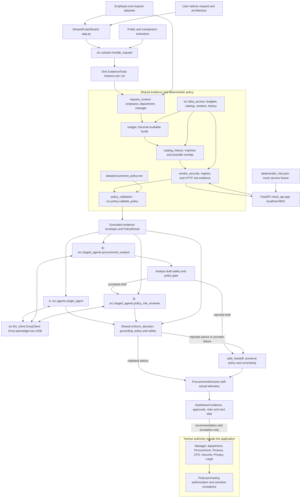

# Architecture and assumptions

Architecture B is selected for shipping; both implementations remain available. The public handler and dashboard initial selection retain Architecture A for compatibility.

The diagram shows logical flow, not extra service calls. All five tools run once on a normal request; the reviewer reuses the original evidence and deterministic policy result rather than retrieving evidence again. Provider failures in either architecture produce a policy-preserving handoff; a rejected analyst draft does not reach the reviewer. Groq performs no arbitrary tool execution.

## Interfaces and trust boundary

- The dashboard and evaluators call the same `handle_request(request_id, architecture)` adapter. Architecture values are `single` and `staged`; unsupported values are rejected.
- `EvidenceTools` returns typed request, budget, catalog, vendor and policy results. Provenance identifies dataset records, policy sections or the vendor HTTP endpoint. The application never reads the vendor-risk fixture as an API-failure substitute.
- A returns `AgentAdvice`; B first returns `AnalystDraft`, then reviewer `AgentAdvice`. Pydantic validates structured output. Shared enforcement retains deterministic approvals, risks, missing information and human review, and verifies model evidence against the canonical evidence trail.
- Business fields, vendor responses and model drafts are untrusted. Prompts separate these from trusted instructions; safety guards reject authorization/bypass claims. These language guards are heuristic and do not replace human review.
- `RunTelemetryCounter` counts actual tool invocations and HTTP attempts, including failures/retries. Public telemetry contains tool names and call counts; evaluation artifacts also measure active time and pacing separately.
- No application component executes purchases, edits budgets, accepts contracts or completes external approvals. The final human boundary represents follow-up outside the product, not an implemented approval integration.

## Assumptions and limits

- Synthetic local datasets and the actual supplied procurement policy are the assessment ground truth. No database, production vendor integration or operating-region inference from employee country is assumed.
- The policy reference date is 2026-09-30; assessment age of 365 days is valid and 366 days is expired. Invalid/future dates remain unverified.
- Annual budget minus committed spend is available funding. Purchase history is context, not an additional deduction. Category overlap is a possible alternative, not proven equivalence or free seats.
- Missing cost does not receive a spend tier; unavailable evidence is never approval. Mandatory human review remains even for otherwise favorable advice.
- Groq credentials are operator-provided and private; analysis sends bounded request evidence to Groq. Model output and availability are nondeterministic. The mock API is local FastAPI, not a production risk service.
- The launcher uses its Python interpreter for both processes. The tested environment is Python 3.12.4 and Streamlit 1.65.0; compatibility across every version allowed by dependency ranges has not been established.
- [Final comparison](ARCHITECTURE_COMPARISON_20261011_132721_049614.md) establishes measured minimum-check and acceptance outcomes on six cases, not independently verified semantic quality. See the [decision memo](ARCHITECTURE_DECISION.md).
